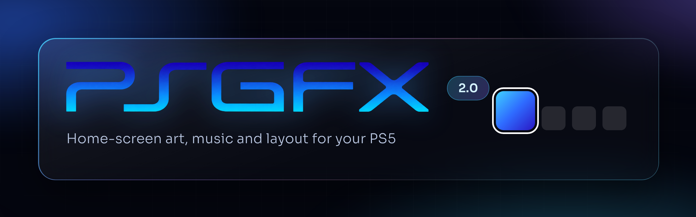
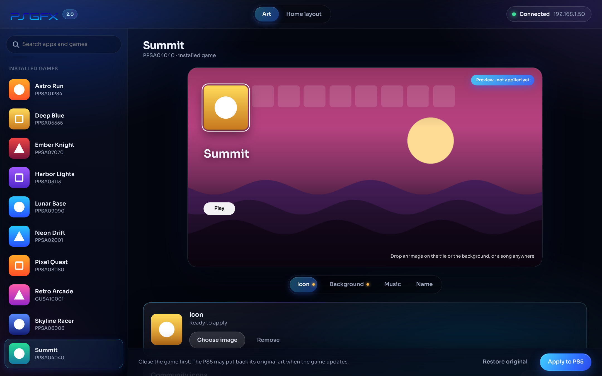
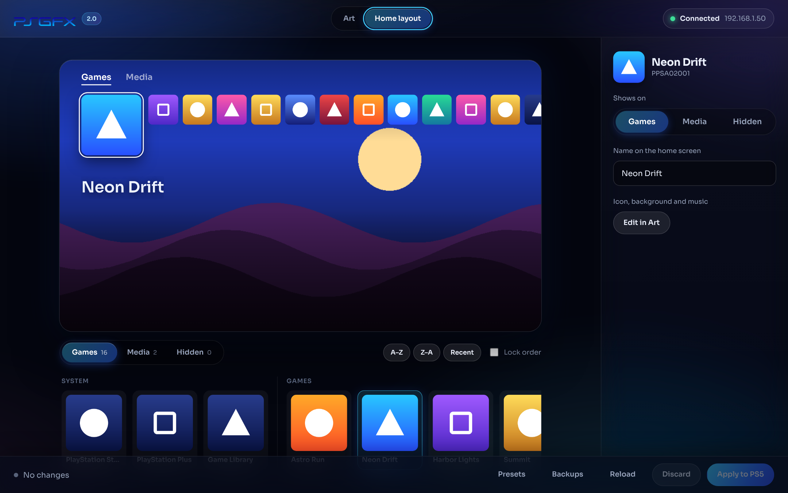
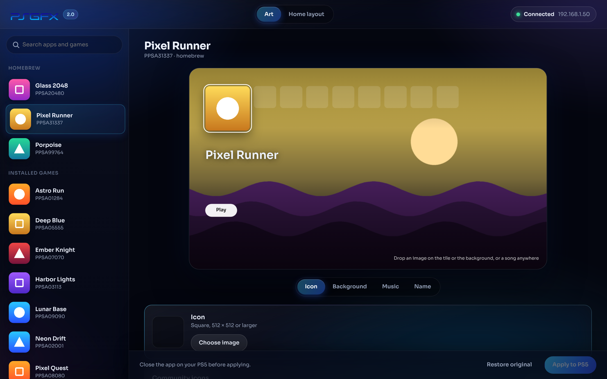
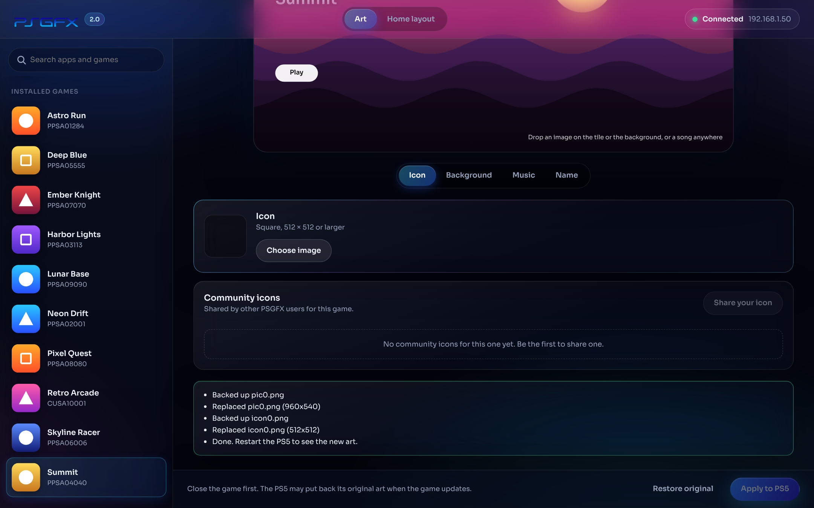

<p align="center">
  
</p>

<p align="center">
  <a href="https://github.com/elripalda/psgfx/releases/latest"></a>
  
  
  <a href="LICENSE"></a>
</p>

<p align="center">
  <a href="https://github.com/elripalda/psgfx/releases/latest"><b>Download PSGFX 2.0</b></a> ·
  <a href="#how-to-use">How to use</a> ·
  <a href="#home-layout">Home layout</a> ·
  <a href="#community-icons">Community icons</a>
</p>

<p align="center">
  <a href="https://ko-fi.com/ripalda"></a>
</p>

PSGFX gives your PS5 homebrew and games new home-screen art, and lets you arrange the home screen itself: hide tiles like the PlayStation Store, rename anything, move apps between Games and Media, and lock your games in the order you want. Pick an app, drop in any image, and click **Apply**. PSGFX resizes and converts it to the exact format the console expects, uploads it to the right folder, and keeps a backup of the original so you can undo it with one click.

It works through [PS5 Upload](https://github.com/phantomptr/ps5upload): keep the PS5 Upload app open on your PC, connected to your console, and PSGFX does its work through it. There's nothing else to install: PSGFX is a single `.exe`.



## Features

- **New look (2.0).** A redesigned, larger glass interface with smooth animations, and a home-screen preview that slides between tiles like the console does.
- **Community icons (new in 2.0).** Browse icons other PSGFX users made for the game you picked and use one in a click, or share yours. Shared icons are stored in a public GitHub repository and moderated.
- **Custom icons.** Use any PNG or JPEG. PSGFX crops it to a square and saves it at the console's native size.
- **Custom backgrounds.** Any 16:9 image becomes the backdrop behind the app on the home screen. Homebrew gets full 4K backgrounds.
- **Homebrew and installed games.** Homebrew apps registered with PS5 Upload show up with their icons, and so do your installed PS4 and PS5 games, with their real names.
- **Live preview.** A replica of the PS5 home screen shows your art before anything touches the console. Drop an image on the tile to set the icon, or anywhere else to set the background.
- **Home-screen music (new in 1.3).** Drop an MP3, WAV or FLAC on an app or game, pick where the clip starts and how long it runs, and listen to it before applying. PSGFX converts it to the PS5's own format (`snd0.at9`, ATRAC9), levels it like official games, and loops it while the tile is selected. Clips can run up to about 85 seconds, the most the PS5's 2 MB limit allows.
- **Rename from the Art view.** Change a homebrew app's or game's home-screen name right next to its art. For homebrew, PSGFX also updates the name in the app's `param.json` so changing its art later keeps the new name.
- **One-click restore.** The first time you change something, PSGFX saves the original next to it. **Restore original** puts it back exactly.
- **Clean list.** System apps and leftovers are tucked away under *Show other items*.
- **Home layout (new in 1.1).** Hide any tile (PlayStation Store, Game Library, PS Plus, media apps), rename games and apps, move apps between the Games and Media tabs, and reorder your games by dragging or with A–Z / Z–A.
- **Lock order.** Keeps your arrangement in place even after you play other games.
- **Layout presets.** Save a layout when you apply it and re-apply it in one click after a firmware update or database rebuild resets the home screen.
- **Home-screen backups.** PSGFX saves the home-screen database before every layout change, plus a copy of the very first one it read. Restore any of them from the Backups dialog.
- **No setup.** A single portable Windows app that opens in your browser. It remembers your PS5's IP address.

## Requirements

- A jailbroken PS5 with **[PS5 Upload](https://github.com/phantomptr/ps5upload)**'s payload running (the same setup you use to upload homebrew).
- **The PS5 Upload app, version 6 or newer, open on the same PC and connected to your PS5.** PSGFX 1.2 and later go through it; PSGFX 1.1 and older only work with PS5 Upload 5.x.
- A Windows PC on the same network.

## How to use

1. Download `PSGFX.exe` from the [latest release](../../releases/latest) and double-click it. PSGFX opens in your browser.
2. Open PS5 Upload and make sure it's connected to your PS5.
3. PSGFX asks for your PS5's IP address (the same one PS5 Upload uses). Enter it and click **Connect**. Next time it connects by itself.
4. Choose a homebrew app or an installed game from the list.
5. Drop an image onto the preview's tile (**icon**) or background (**background**), or use the **Choose image** buttons.
6. Close that app or game on the PS5, then click **Apply to PS5**.
7. Restart the PS5 to see the new art on the home screen.

To undo, select the app and click **Restore original**.

### Home layout

1. Connect, then click **Home layout** at the top.
2. Pick a tile in the strip under the preview. Choose **Games**, **Media** or **Hidden**, or type a new name. When a tile leaves the tab you're on, the next one is selected so you can keep going, and **Undo** brings it back.
3. Drag games into any order, or use **A–Z** / **Z–A**. Tick **Lock order** to keep it that way after you play other games.
4. Click **Apply to PS5**, optionally saving the layout as a preset, then restart the PS5.



PSGFX edits the console's home-screen database (`/system_data/priv/mms/app.db`) through PS5 Upload. It uploads the new database to `/data/psgfx` and has PS5 Upload's console shell copy it into place, then reads it back to check it. Backups and presets are kept in the **PSGFX Layout** folder next to `PSGFX.exe`. If the home screen ever looks wrong, restore a backup, or use Safe Mode → **Rebuild Database**. App Library always comes back on its own; the system adds it regardless of the database.

### Community icons

Pick an app or game: the **Icon** tab shows icons other people shared for it. Click one to use it, then **Apply to PS5**. To share yours, choose or drop an icon, click **Share your icon**, and accept the guidelines. It goes live right away. Use the ⚑ on an icon to report it.

The library is run by `community-server/` (a few PHP files on the PSGFX website that save icons to a public GitHub repository). See [community-server/SETUP.md](community-server/SETUP.md).



## Tips

- **Image sizes:** icons look best at 512 × 512 or larger. Backgrounds look best at 3840 × 2160. PSGFX crops and scales anything else automatically.
- **Game updates:** the PS5 may put back a game's original art when that game updates. Apply yours again afterwards.
- **Windows SmartScreen:** the app isn't code-signed, so Windows may warn the first time. Click **More info → Run anyway**. If the firewall asks, allow PSGFX on private networks.
- **Quitting:** close the black console window.



## Build from source

PSGFX is plain C++17 with no external dependencies. Everything it needs is in `src/lib` (including the SQLite amalgamation used for Home layout).

```bash
# Linux / WSL: produces build/PSGFX.exe
sudo apt install g++-mingw-w64-x86-64
./build.sh

# Native Linux binary for development
./build.sh linux
```

On Windows, run `./build.sh` from an [MSYS2](https://www.msys2.org/) MinGW shell. Pushing a tag such as `v1.0.0` builds the exe on GitHub Actions and attaches it to a release.

### How it works

PSGFX runs a small local web server (127.0.0.1 only) and opens your browser to it. PS5 Upload 6.0 replaced its old protocol (FTX2, ports 9113 and 9114) with AVA1, an encrypted connection on port 9120 that the console only opens to an app it has paired with. So PSGFX doesn't talk to the console itself: it sends each command to the PS5 Upload app's local engine (`POST http://127.0.0.1:19113/api/mgmt/call`), which runs it over its paired connection. It uses the payload's existing commands to list apps, read and write files, and back up. Homebrew art is written to the app's `sce_sys` folder and to the home-screen metadata folder. Game art is written to `/user/appmeta/<title id>` in the same size and format as the original files. When the home-screen database (`app.db`) shows the game's tile art coming from somewhere PSGFX can't write, such as inside the game's own package, PSGFX writes the image to `/user/appmeta/<title id>/psgfx_*` and points the database at it. It keeps the original paths in `psgfx_original.json` for **Restore original** and backs up the database first, as Home layout does. Backgrounds are encoded as BC7 DDS where the console uses DDS. Music becomes `snd0.at9` (ATRAC9, 48 kHz stereo, 192 kb/s, looped), written to the app's `sce_sys` folder for homebrew and to `/user/appmeta/<title id>` for games, with its loudness in `param.json` (`pubtools.loudnessSnd0`).

`tools/mock_engine.py` is a stand-in for the PS5 Upload engine and console that serves a folder on your computer as if it were a PS5. Use it to develop without a console:

```bash
python3 tools/mock_engine.py ./fake-ps5 39200 &
PS5AS_ENGINE=127.0.0.1:39200 ./build/psgfx
```

If PS5 Upload's engine runs somewhere else (a NAS or Docker), add `"engine": "host:port"` to `psgfx.json`.

## Credits

- [PS5 Upload](https://github.com/phantomptr/ps5upload) by phantomptr, whose app and payload PSGFX works through
- [PS5 AT9 Converter](https://github.com/blackbearreloaded/ps5-at9-converter) by BlackBearReloaded, whose ATRAC9 encoder PSGFX's music feature is ported from, and [LibAtrac9](https://github.com/Thealexbarney/LibAtrac9) by Alex Barney
- [bc7enc](https://github.com/richgel999/bc7enc) by Rich Geldreich, [stb](https://github.com/nothings/stb) by Sean Barrett, [BLAKE3](https://github.com/BLAKE3-team/BLAKE3), [JSON for Modern C++](https://github.com/nlohmann/json) by Niels Lohmann, and the [Sora](https://github.com/sora-xor/sora-font) typeface. See [THIRD_PARTY_NOTICES.md](THIRD_PARTY_NOTICES.md).

## License

PSGFX is free software under the [GNU General Public License v3.0 or later](LICENSE). Versions up to 1.2 were released under the MIT License; 1.3 moved to the GPL because it includes the ATRAC9 encoder from [PS5 AT9 Converter](https://github.com/blackbearreloaded/ps5-at9-converter), which is GPL-3.0-or-later.

PSGFX is an independent fan project. It is not affiliated with, endorsed by, or sponsored by Sony Interactive Entertainment. "PlayStation" and "PS5" are trademarks of Sony Interactive Entertainment Inc. Only use PSGFX with games you own.

## Support

PSGFX is free. If it made your PS5 look the way you want, you can buy me a coffee on [Ko-fi](https://ko-fi.com/ripalda). Thank you!
